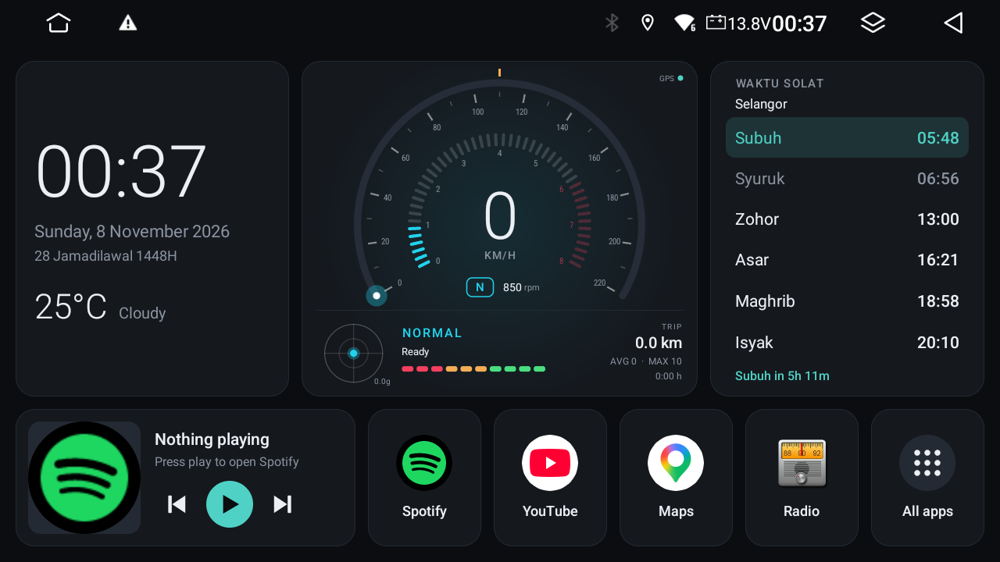
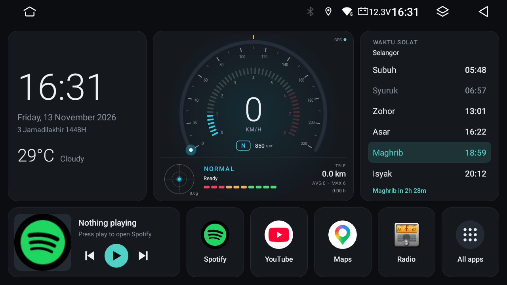
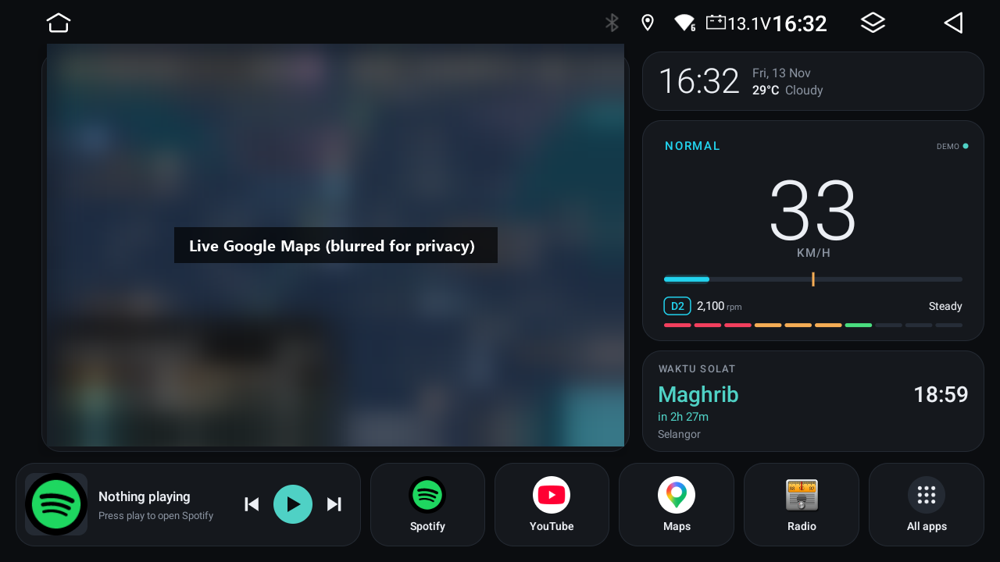
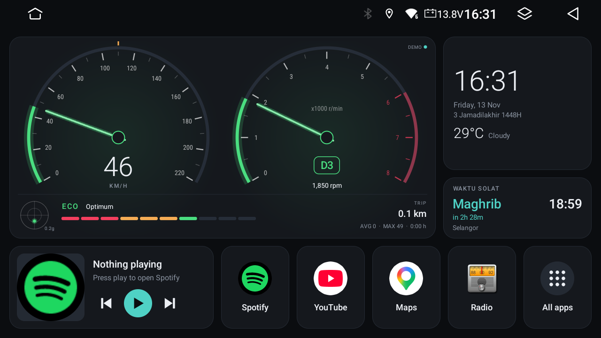
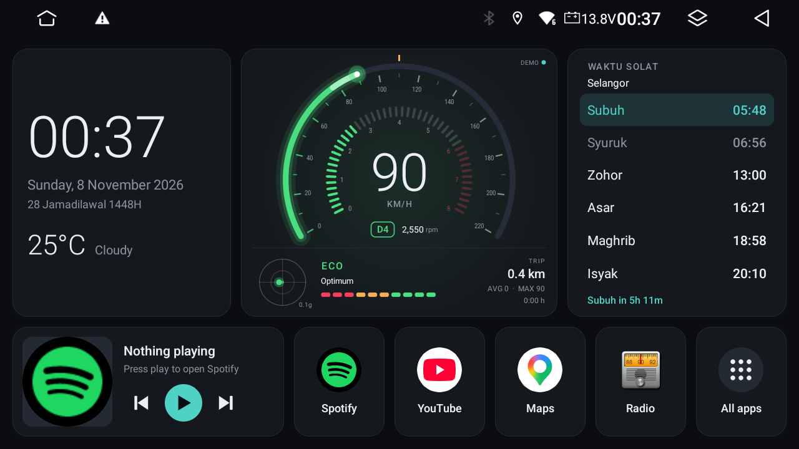
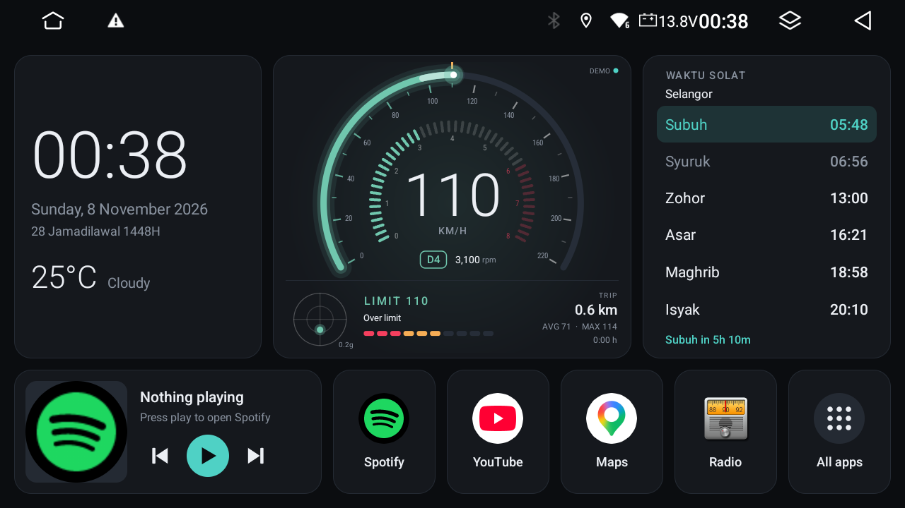
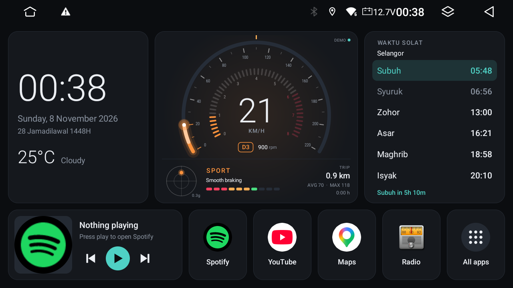

# Fazz Launcher

A custom launcher for Android car head units, plus a complete, **no-root** guide to getting ADB over Wi-Fi on Topway units. It covers safe debloating, diagnosing vendor app crashes, and a launcher with three skins (a futuristic drive cluster, live Google Maps on the home screen, and classic twin dials), prayer times and a media card.

Built and tested on a **Topway T9** head unit (Allwinner T527, Android 13, 1280×720), from a Windows PC on the same Wi-Fi.

> ⚠️ **Use at your own risk.** Fazz Launcher and this guide were tested on one head unit only (the author's Topway T9). Other units, firmware versions and brands may behave differently. Changing a head unit over ADB can, in the worst case, leave it unusable (bricked). The author is not responsible for any damage, data loss or problems. See [Disclaimer](#disclaimer).



### Skins (new in 2.0)

Pick one from **All apps → Skins**, or long-press the clock.

| 1 · Classic | 2 · Map | 3 · Twin dials |
|---|---|---|
|  |  |  |
| Clock, drive cluster, all prayer times | The real Google Maps app in a window on the home screen, digital speed, next prayer | Analog speedometer and tachometer, next prayer |

| Cruising (ECO) | Over the speed limit | Hard braking (SPORT) |
|---|---|---|
|  |  |  |

## Features

- **Three skins:** Classic, Map and Twin dials. Choose from **All apps → Skins**, by long-pressing the clock, or from the cluster menu. The trip, speed limit and demo carry over when you switch.
- **Live Google Maps on the home screen (skin 2):** the real Google Maps app runs in a window inside the home screen, the same way the stock Topway launcher does it. No API key. Tap the Maps tile for full screen; press Home and it goes back into the window. Needs Topway firmware with the navigation-window feature and Google Maps set as the navigation app (see [docs/04-how-it-works.md](docs/04-how-it-works.md#skin-2-the-google-maps-window)).
- **Drive cluster**
  - GPS speed ring with a glow (0–220 km/h);
  - **simulated** RPM ring (0–8,000) and gear chip (N, D1–D4) from a configurable gearbox model;
  - G-ball (real acceleration, braking and cornering force from GPS);
  - ECO / NORMAL / SPORT driving feedback, with a colour that follows how you drive, and braking feedback ("Braking", "Smooth braking", "Hard braking");
  - speed-limit warning;
  - trip computer: distance, average, top speed and drive time. It resets after the car has been off for 30 minutes.
  - Long-press the cluster for the speed limit, reset trip, a 60-second demo drive, or the skin.
- **Clock panel:** time, date and Hijri date, plus current weather.
- **Waktu solat:** JAKIM prayer times for your GPS zone, with the next prayer highlighted and a countdown (skins 2 and 3 show only the next prayer). The location line shows town, state and zone code. It works offline once loaded. Malaysia only.
- **Media card:** shows what Spotify, YouTube or Bluetooth music is playing, with previous, play/pause and next.
- **Shortcuts:** Spotify, YouTube, Google Maps and Radio, plus an **All apps** drawer whose first entry is always **Stock Home**.
- **Small:** about 50 KB, no libraries, no ads, no analytics. Your location is only sent to the weather, prayer-time and place-name services.

> **About RPM:** most head units receive no engine data from the car, so the RPM and gear are **estimated** from GPS speed and acceleration through a gearbox model. Set it up for your own car using [docs/03-customize.md](docs/03-customize.md).

## Quick start

1. **Turn on ADB over Wi-Fi** on the head unit: [docs/01-enable-adb.md](docs/01-enable-adb.md).
   - On Topway: Developer options PIN `7890`, then Wireless debugging password `john@tw-desktop`, then `adb connect <ip>:5555`.
2. **Install:**
   - Easiest: the ready-made APK from [Releases](https://github.com/fazrilamin/fazzlauncher/releases) (also in [`release/`](release/)), made for Topway 1280×720 units.
   - Or build it yourself: [docs/02-build-install.md](docs/02-build-install.md).
   ```
   adb install -r release/FazzLauncher-2.1.apk
   adb shell pm grant com.fazrilamin.fazzlauncher android.permission.ACCESS_FINE_LOCATION
   adb shell cmd notification allow_listener com.fazrilamin.fazzlauncher/com.fazrilamin.fazzlauncher.MediaListener
   adb shell am start -n com.fazrilamin.fazzlauncher/.MainActivity                       # try it first
   adb shell cmd package set-home-activity com.fazrilamin.fazzlauncher/.MainActivity    # make it the home screen
   ```
3. **Undo any time:**
   - On the unit: Settings → Apps → Default apps → Home app, or use Fazz Launcher's **All apps → Stock Home**.
   - Over ADB: `adb uninstall com.fazrilamin.fazzlauncher`.

Release APK (2.1) SHA-256: `bf8fbf017ed686dea0cf2f4f3a9a7ebd46ac7f2e824f092213cf5de81b924fb4`. What changed: [CHANGELOG.md](CHANGELOG.md).

## Using an AI agent (Claude Code, Codex)

This repo is written so an AI coding agent can repeat the whole setup on **your** unit and car.
- **The playbook:** [AGENTS.md](AGENTS.md) has the safety rules, the questions to ask you, step-by-step phases, the code map and diagnostics. Claude Code loads it through [CLAUDE.md](CLAUDE.md).
- **A prompt to paste:** [docs/ai-prompt.md](docs/ai-prompt.md).

## Documentation

| Guide | What's inside |
|---|---|
| [01 – Enable ADB](docs/01-enable-adb.md) | Topway codes, connecting, what didn't work, other brands |
| [02 – Build & install](docs/02-build-install.md) | Toolchain setup, build, permissions, set as home, undo |
| [03 – Customise](docs/03-customize.md) | Skins, shortcuts, stock home, gearbox model, dial scales, prayer times, colours, other screens |
| [04 – How it works](docs/04-how-it-works.md) | Architecture, data flow, cache, cluster maths, network |
| [05 – Debloat](docs/05-debloat.md) | Which vendor apps are safe to remove (reversibly), which to never touch |
| [06 – Radio crash case study](docs/06-radio-crash.md) | Tracing a vendor app's crash from logs and bytecode, without root |
| [07 – Troubleshooting](docs/07-troubleshooting.md) | Common problems and fixes |

Helper scripts in [`tools/`](tools/):
- `find-headunit.ps1` / `.sh` find the unit on your Wi-Fi.
- `setup-toolchain.ps1` installs JDK 17 and the Android SDK on Windows.

## Compatibility

| | Status |
|---|---|
| Topway T9 / Allwinner T527 / Android 13 / 1280×720 | Tested daily |
| Other Topway units (TS10, TS18, …) | The ADB method is likely the same; the launcher layout may need adjusting |
| Other brands (FYT, MTCx, …) | The launcher should run on Android 9+; ADB steps and vendor packages differ |
| Build on Windows (Git Bash) | Tested |
| Build on macOS / Linux | Same steps; not tested yet |

## Disclaimer

- **Use at your own risk**, and only on a unit you own. There is no warranty: as the [MIT licence](LICENSE) says, the software is provided "as is".
- **Tested on one unit only:** a Topway T9 (Allwinner T527, Android 13, 1280×720). The skins, and especially skin 2's Google Maps window (a Topway firmware feature), may not work, or may work differently, on other units or firmware.
- **Bricking risk:** ADB commands, removing vendor apps and changing system settings can make a head unit unstable or, in the worst case, unusable. Read [docs/05-debloat.md](docs/05-debloat.md) before removing anything, and never remove the stock launcher.
- **The author is not responsible** for any damage to your head unit, car or data, for lost warranty, or for anything else that happens from using this project.
- Don't operate the head unit or follow these steps while driving.
- This project isn't affiliated with Topway, DoFun, Google, or any car maker. The RPM and gear readings are estimates, not engine data.

## Credits

- Topway Developer options and debugging codes: [StarMusa88/TopWay-Android-Headunit-ADB-Guide](https://github.com/StarMusa88/TopWay-Android-Headunit-ADB-Guide)
- Prayer times: [waktusolat.app](https://api.waktusolat.app) (JAKIM data)
- Weather: [Open-Meteo](https://open-meteo.com)
- Place names: © [OpenStreetMap](https://www.openstreetmap.org/copyright) contributors (Nominatim)
- Built with [Claude Code](https://claude.com/claude-code).

## Licence

[MIT](LICENSE) © 2026 [fazrilamin](https://github.com/fazrilamin)
